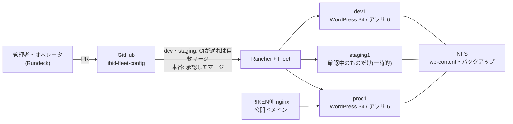

# ibid-fleet-config

dev → staging → production の3つのRKE2クラスタ(Harvester上、Rancher管理)で
数十のWordPressサイトと自作アプリを運用するためのFleet(GitOps)構成リポジトリ。

## 全体像

**仕組みを図で見るなら [docs/architecture.md](docs/architecture.md)(IBID基盤の仕組み)**:
全体構成、3つの環境、GitOps、変更の流れ、WordPressの中身とデータ、自作アプリのイメージ、秘密情報、監視、人と権限。

- **単一mainブランチ + 環境別ディレクトリ**(`envs/dev|staging|production`)。
  環境ごとのGitRepo([fleet-bootstrap/](fleet-bootstrap/))が自分の環境のディレクトリ
  だけを監視し、`env=<環境名>` ラベルのクラスタへ適用する。
- **昇格(プロモーション)はPRで制御**する。`envs/production/` 配下は
  [CODEOWNERS](.github/CODEOWNERS) により承認必須(mainブランチ保護)。
  承認済みマージのみが本番クラスタに届く。
- サイト・アプリのバンドルは**全環境で同一内容**にし、環境差分はクラスタラベルで選ぶ。
  昇格はディレクトリの丸ごとコピーで完結する。
- Gitで昇格するのは**構成のみ**(チャートバージョン、values、イメージ)。
  DBデータ・wp-contentは昇格しない。
- 本番へは**必ずstagingを通す**(dev → staging → production)。stagingには確認中のサイト・アプリだけを
  一時的に置き、本番データを入れて確かめてから本番へ昇格し、終わったら消す
  (stagingは2026-10-08に一度廃止し、2026-10-25にstaging1で再導入)。

## 現在の構成(2026-10-25時点)

| | dev1(`env=dev`) | staging1(`env=staging`) | prod1(`env=production`) |
|---|---|---|---|
| ノード | control-plane 3台(SSD) + worker 5台 | 3台(全役割兼任、SSD、8GiB) | control-plane 3台(SSD) + worker 7台 |
| WordPressサイト | 34(17サイト × `/ja`の`<site>`・`/en`の`<site>-en`。公開は`wpdev1.brc.riken.jp`、[6b.](docs/manual-wordpress-restore.md)) | 確認中のものだけ(同時に4つまで。外部公開しない) | 34(devと同じ構成。公開は旧サイトと同じ`<site>.brc.riken.jp`) |
| 自作アプリ | 7(brc-advanced-search、riken-diips、sparqlist、metadatabase-v2、brc-cross-search-xsearch、brc-cross-search-resource、member-gateway) | 6(member-gateway以外。devと同じ) |
| TraefikのLB IP(IPPool) | `192.168.1.33`(pool1 `.30-.49`) | `192.168.1.99`(pool3 `.90-.100`) |
| ホスト名(DNS) | `<site>.dev.ibid.lan`(`*.dev`のワイルドカード) | `<site>.production.ibid.lan`(`*.production`のワイルドカード) |

WordPressのデータの置き場所:

| データ | StorageClass | 実体 | 定期バックアップ |
|---|---|---|---|
| wp-content | `nfs-external` | NFS `192.168.1.1:/data/nfs/wordpress/<env>/` | サイトのCronJob(日次、14日分、NFS `/data/nfs/backup/<env>/`) |
| MariaDB | `harvester` | Harvester側のボリューム | 同上(DBダンプ) |
| (参考)Prometheus等 | `longhorn`/`longhorn-r1` | ゲストLonghorn | Longhornの日次バックアップ(NFS `/data/nfs/longhorn/<env>`) |
| (参考)sparqlistの`repository/` | 静的PV(NFS) | NFS `192.168.1.1:/data/nfs/sparqlist/shared/repository`(dev/production共有) | NFSサーバー側の二次コピーのみ |

WordPressのバックアップCronJobはチャート0.6.0から(2026-10-09に両環境へ導入)。NFSサーバー上のデータの二次コピーは、組織のBaculaのバックアップで取られている(本リポジトリの管理外)。
([docs/roadmap.md](docs/roadmap.md)の項目5)。戻し方は
[docs/manual-wordpress-restore.md](docs/manual-wordpress-restore.md)「日次バックアップ」。

## ドキュメント

**日常の運用手順(手順だけを短くまとめたもの)は [docs/runbook/](docs/runbook/README.md)**:
WordPressの新規サイト作成・更新、自作アプリの新規展開・更新、トラブルシューティング。
以下は背景・設計を含む詳しい手順書。

まず読むもの:

| 文書 | 内容 |
|---|---|
| [docs/architecture.md](docs/architecture.md) | **IBID基盤の仕組み(図による解説)**。初めての人はここから |
| [docs/operations-flow.md](docs/operations-flow.md) | 日常の変更の流れ(dev → staging → production)、stagingでの確認、QAゲート、環境差分の書き方、本番反映前のバックアップ |
| [docs/manual-multi-env.md](docs/manual-multi-env.md) | GitHub設定、**クラスタの新規作成チェックリスト**(2.)、日常運用・定期メンテナンス、バックアップ、封印鍵、break-glass、DR |
| [docs/roadmap.md](docs/roadmap.md) | 決定事項の記録と、残っている課題(優先度つき) |
| [docs/manual-tooling-setup.md](docs/manual-tooling-setup.md) | 作業端末のツール(kubectl/helm/kubeseal/gh等)とkubeconfig |

作業別の手順:

| 作業 | 文書 |
|---|---|
| WordPressサイトの追加・削除、プラグイン管理 | [docs/manual-wordpress.md](docs/manual-wordpress.md) |
| WordPressのデータ移行・リストア、外部リバースプロキシ経由の公開 | [docs/manual-wordpress-restore.md](docs/manual-wordpress-restore.md) |
| 自作アプリ(`apps/`)の追加・昇格、アプリ別のメモ | [docs/manual-apps.md](docs/manual-apps.md) |
| Rundeckのパイプライン(アプリのdev/本番更新、WordPressの本番コンテンツ→dev・stagingでの確認・本番昇格) | [docs/manual-rundeck.md](docs/manual-rundeck.md) |
| 監視・アラート(rancher-monitoring + Slack) | [docs/manual-monitoring.md](docs/manual-monitoring.md) |
| TLS証明書(cert-manager + FreeIPA ACME)、DNS登録 | [docs/manual-cert-manager-freeipa-acme.md](docs/manual-cert-manager-freeipa-acme.md) |
| IPPool、TraefikのLoadBalancer化、Rancher chartValuesの注意 | [docs/manual-harvester-loadbalancer.md](docs/manual-harvester-loadbalancer.md) |
| control-plane VMのディスクをSSDに限定(etcd遅延対策) | [docs/manual-harvester-etcd-ssd.md](docs/manual-harvester-etcd-ssd.md) |
| ノードの時刻同期(chrony)とノードのUser Data | [docs/manual-node-ntp.md](docs/manual-node-ntp.md) |
| Rancher管理サーバのDocker版→K3s+Helm移行、アップグレード、Rancherのバックアップ | [docs/manual-rancher-migration.md](docs/manual-rancher-migration.md) |

障害対応・記録:

| 文書 | 内容 |
|---|---|
| [docs/manual-dr-troubleshooting.md](docs/manual-dr-troubleshooting.md) | DR・ボリューム復元・ノード入れ替えで詰まった点と対処(Machine削除の停止など) |
| [docs/manual-storage-migration.md](docs/manual-storage-migration.md) | 【完了済み】既存サイトのPVCを`harvester`/`longhorn-r1`/`nfs-external`へ移した記録 |
| [docs/wordpress-site-delegation.md](docs/wordpress-site-delegation.md) | サイト管理を他チームへ委譲する際の運用設計(検討記録) |
| [envs/README.md](envs/README.md)、[fleet-bootstrap/README.md](fleet-bootstrap/README.md) | 環境別ディレクトリとGitRepo定義の説明 |

## ディレクトリ構成

- `envs/<env>/`: 環境別のFleetバンドル(`infra/`・`sites/`・`apps/`・`secrets/`)。
  [envs/README.md](envs/README.md)
- `charts/ibid-wordpress/`: 全サイト共通デフォルトを内包したラッパーチャート
  (Bitnami `wordpress` を依存に持つ)。値を変えたら`Chart.yaml`のversionを上げる。
  mainマージで `release-chart.yaml` がGHCRへ公開し、各サイトの `helm.version` を上げて取り込む
- `images/<app>/`: 自作アプリのビルド定義(アプリ本体は別リポジトリ。`SRC_REF`で固定)
- `fleet-bootstrap/`: 環境別GitRepo定義(Rancher localクラスタへ手動適用する控え)
- `rundeck/`: Rundeckのジョブ定義(`generate-jobs.py` が `envs/dev/` から生成。自作アプリは
  プロジェクト `Rancher-AppControll`、WordPressは `WordPressControl`)。[docs/manual-rundeck.md](docs/manual-rundeck.md)
- `.github/workflows/`:
  - `validate`: PR検証(YAML構文、fleet.yamlの必須キー、helm lint/template)
  - `promote`: 昇格PR生成(手動起動。`to=staging`でdev→staging(auto-merge)、`to=production`でstaging→production。`kind`に`sites`/`apps`、`name`に名前か`all`)
  - `release-chart`: チャート公開
  - `auto-update`: 毎週月曜、WordPress/MariaDBイメージとプラグインの更新をdevへ自動反映(`bump-chart.sh`・`bump-plugins.sh`)
  - `build-<app>-image`: 自作アプリのイメージ公開(brc-advanced-search、riken-diips、sparqlist、metadatabase-v2、brc-cross-search-xsearch、brc-cross-search-resource、member-gateway)

## スクリプト

| スクリプト | 用途 |
|---|---|
| `scripts/new-wordpress-site.sh <env> <site>` | サイトのfleet.yamlをひな形から生成 |
| `scripts/seal-site-secrets.sh <env> <site>` | サイトの認証情報Secret(3種)をSealedSecretとして生成(環境ごと・サイトごとにランダム) |
| `scripts/restore-wordpress.sh <site> <dir> [ts]` | `yyyymmdd_hhmm.tar.lzo`/`.dump.lzo`のバックアップをサイトへリストア |
| `scripts/bump-chart.sh [--update-images] "<種類>: <説明>"` | ラッパーチャートの変更(WordPress/MariaDBのdigest更新を含む)を公開し、devの全サイトへ反映するまでを一括実行 |
| `scripts/bump-plugins.sh [--dry-run]` | devの全サイトのプラグインをWordPress.orgの最新版へ上げるPRを作成・マージ |
| `scripts/update-app-image.sh <subcommand>` | 自作アプリのイメージ更新(`set-image`でdev反映まで一括)〜dev→staging→production昇格PR。Rundeck用に `dev-update`・`staging-update`・`release-production` |
| `scripts/wordpress-pipeline.sh <subcommand>` | WordPressのパイプライン(本番コンテンツ→dev、stagingでの確認、本番昇格、バックアップ・確認)。Rundeckの `WordPressControl` から呼ぶ |
| `scripts/seal-monitoring-secret.sh <env>` | アラート通知用Slack Webhook URLのSealedSecret |
| `scripts/seal-sparqlist-secret.sh <env>` | sparqlistのADMIN_PASSWORDのSealedSecret |
| `scripts/deploy-wordpress.sh <env> <site>` | **緊急用(break-glass)**の手動デプロイ。通常はPRマージ→Fleet適用 |
| `scripts/bootstrap-site-secrets.sh <site>` | **緊急用**。Secretをクラスタへ直接作成 |

## 主なフロー

- **クラスタの新規作成・再作成**: [docs/manual-multi-env.md](docs/manual-multi-env.md)の
  「2. クラスタの新規作成」のチェックリストに従う(SSDイメージ、User Data、anti-affinity、
  2枚目のNIC、chartValues、IPPool、`env`ラベル、封印鍵)。
- **サイトの追加**: `seal-site-secrets.sh dev <site>` と `new-wordpress-site.sh dev <site>` の
  生成物を1つのPRにしてマージ → devで確認(DNSはワイルドカードなので登録不要) → stagingで確認
  (`wordpress-pipeline.sh staging-start <site>`)→ 本番へ昇格
  (本番用のSealedSecretは`seal-site-secrets.sh production <site>`で別に作る)。
  [docs/manual-wordpress.md](docs/manual-wordpress.md)
- **設定変更・バージョンアップ**: devのfleet.yamlやチャートを変更 → devで確認 →
  stagingで本番データに対して確認(QAを含む) → 本番のバックアップ → stagingから本番へ昇格 → stagingから削除。[docs/operations-flow.md](docs/operations-flow.md)
- **QAゲート**: 本番への昇格PRは、同じ内容がstagingでQA(`scripts/qa.sh`。[qa/checks.yaml](qa/checks.yaml) の
  HTTP応答・中身のチェック)に通っていることを `qa-gate` が確かめる。[docs/operations-flow.md](docs/operations-flow.md)「QAゲート」
