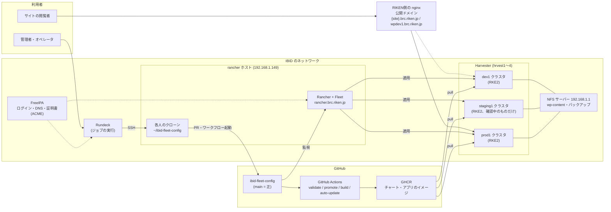
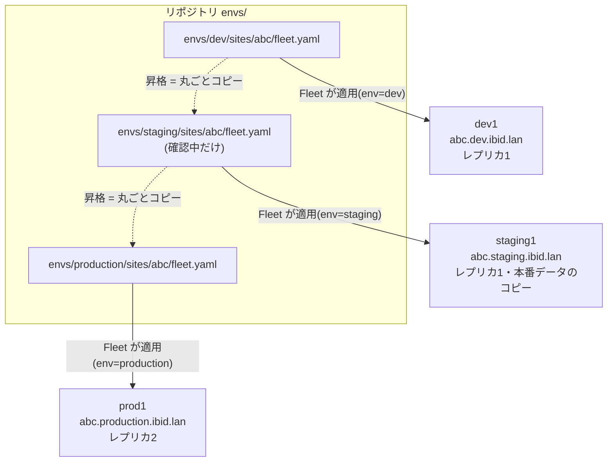
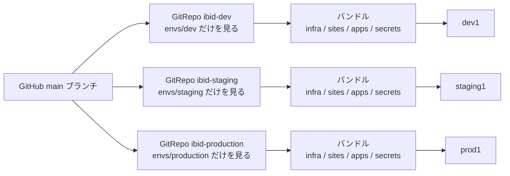
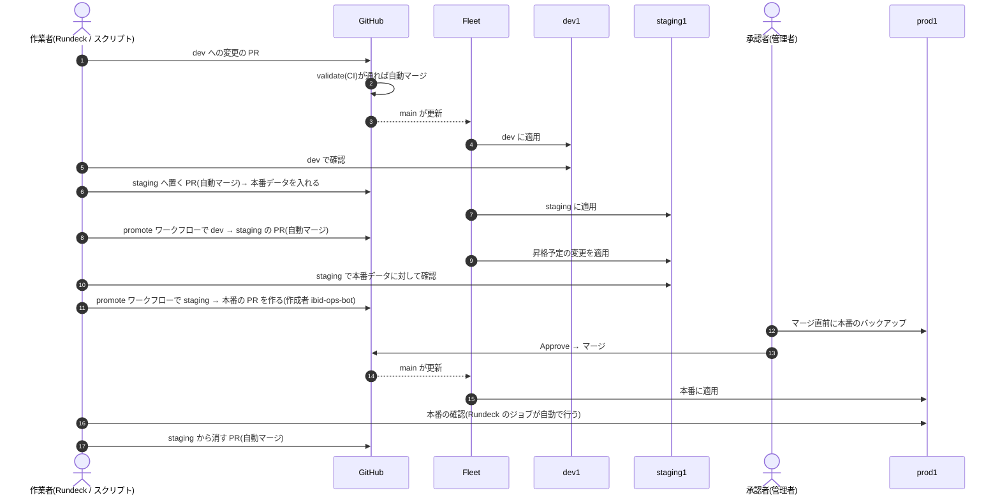
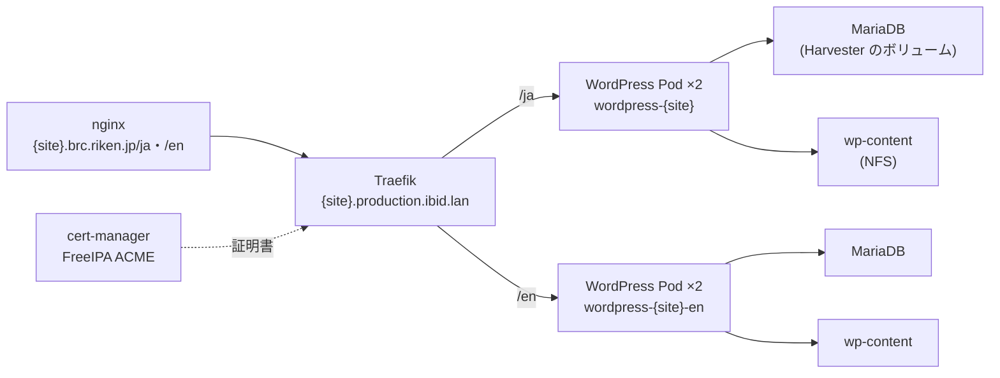
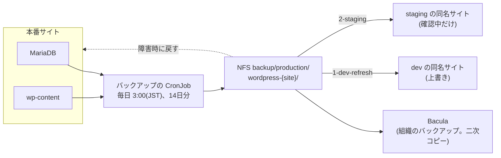
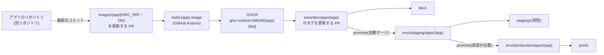
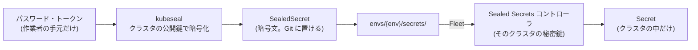
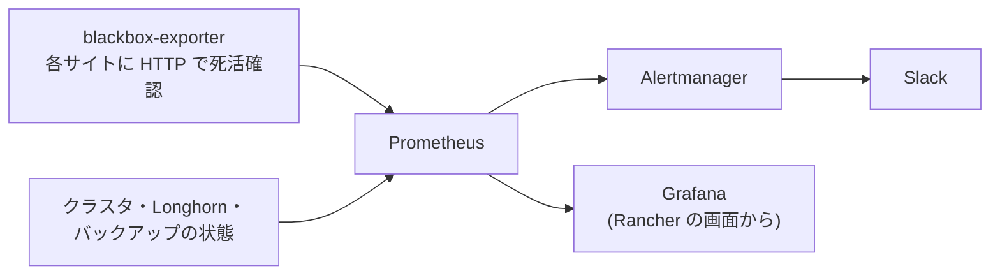
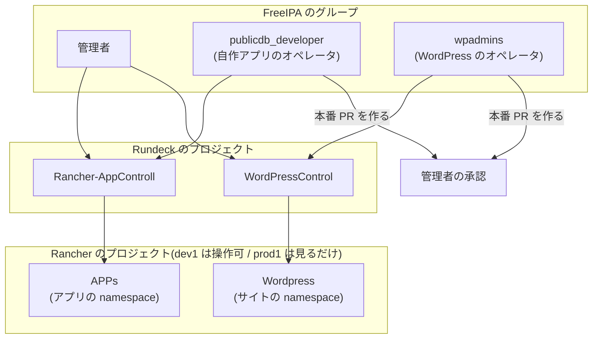

# IBID基盤の仕組み

WordPressサイトと自作アプリを動かしているIBID基盤が、どう組み立てられていて、変更やデータがどう流れるかを、
1章1テーマの図で説明する。手順は書かない(各章の最後に、詳しい手順書へのリンクがある)。
図はGitHub上でそのまま表示される(Mermaid)。図の中の `{site}`・`{app}` はサイト名・アプリ名。2026-10-20時点の構成。

1. [全体構成](#1-全体構成)
2. [3つの環境とバンドル](#2-3つの環境とバンドル)
3. [GitOps: Gitが正、Fleetが適用する](#3-gitops-gitが正fleetが適用する)
4. [変更の流れ: dev → 本番](#4-変更の流れ-dev--本番)
5. [WordPressサイトの中身](#5-wordpressサイトの中身)
6. [WordPressのデータとバックアップ](#6-wordpressのデータとバックアップ)
7. [自作アプリのイメージ](#7-自作アプリのイメージ)
8. [秘密情報(Sealed Secrets)](#8-秘密情報sealed-secrets)
9. [監視とアラート](#9-監視とアラート)
10. [人と権限](#10-人と権限)

## 1. 全体構成

- 開発(dev1)・確認(staging1)・本番(prod1)の3つのKubernetesクラスタが、Harvester(4台の物理ホスト)のVMの上で動く
- Rancherが3つのクラスタを管理し、その中のFleetがGitHubのリポジトリを見て、クラスタに設定を適用する
- 公開ドメインへのアクセスは、RIKEN側のnginxから各クラスタの入口(Traefik)に届く
- 人の作業は、Rundeckのジョブ(またはrancherホストでのスクリプト)からPRを作る形で行う。クラスタを直接変更しない
- ログインはFreeIPAのアカウント(Rancher・Rundeck・サーバー)

詳しく: [manual-multi-env.md](manual-multi-env.md)、[manual-harvester-loadbalancer.md](manual-harvester-loadbalancer.md)

## 2. 3つの環境とバンドル

| | dev1(`env=dev`) | staging1(`env=staging`) | prod1(`env=production`) |
|---|---|---|---|
| 役割 | 更新の互換性テスト | 本番へ出す前の、本番データでの確認 | staging で確かめた変更の反映だけ |
| WordPressサイト | 34(17サイト × 日本語版・英語版) | 確認中のものだけ(同時に4つまで) | 34(同じ) |
| 自作アプリ | 7 | 確認中のものだけ | 6 |
| 入口(Traefik)のIP | `192.168.1.33` | `192.168.1.50` | `192.168.1.99` |
| ホスト名 | `*.dev.ibid.lan` | `*.staging.ibid.lan` | `*.production.ibid.lan` |

- サイト・アプリの設定ファイル(バンドル)は、**dev と本番で同じ内容**にする。環境で変わる値
  (ホスト名、レプリカ数、公開ドメイン)は、ファイルの中でクラスタの `env` ラベルを見て選ぶ
- だから昇格は「dev → staging → 本番 とディレクトリを丸ごとコピーする」だけで済み、PR の差分は昇格させたい変更
  (チャートの版・プラグインの版・イメージのタグ)だけになる
- 本番へは必ず staging を通す。staging には確認中のサイト・アプリだけを置き、本番データを入れて確かめ、
  本番へ昇格したら消す(staging は2026-10-08に一度廃止し、2026-10-25に staging1 で再導入)

詳しく: [operations-flow.md](operations-flow.md)「環境差分の書き方」

## 3. GitOps: Gitが正、Fleetが適用する

- `main` にマージされた内容だけがクラスタに届く。Fleet は数十秒ごとに `main` を見て、差があれば適用する
- 1つのディレクトリ(`envs/<env>/sites/<site>` など)が1つの「バンドル」になる
- サイトとアプリのバンドルは `keepResources: true`。Git からファイルを消しても、クラスタ上のデータ(PVC)は消えない
  (サイトの削除は手作業)
- クラスタで手で変えた設定は、Fleet が Git の内容に戻す。直したいときは Git を直す

詳しく: [envs/README.md](../envs/README.md)、[fleet-bootstrap/README.md](../fleet-bootstrap/README.md)

## 4. 変更の流れ: dev → staging → 本番

- **dev・staging への変更は自動でマージされる**(CI が通れば)。WordPress 本体・プラグインの新しい版は、毎週月曜 9:00 に
  `auto-update` ワークフローが dev へ入れる
- **本番への変更は、必ず人(Code Owner)が承認してマージする**。スクリプトやジョブは本番の PR をマージしない
- Git で本番に出るのは**構成だけ**(チャートの版、設定値、イメージのタグ)。記事などのコンテンツは本番から dev への一方向

詳しく: [operations-flow.md](operations-flow.md)、[runbook/wordpress-update.md](runbook/wordpress-update.md)、[runbook/app-update.md](runbook/app-update.md)

## 5. WordPressサイトの中身

- 1つのドメインの `/ja` と `/en` は、別々の WordPress(`<site>` と `<site>-en`)。それぞれに専用の MariaDB と wp-content がある
- 全サイトの共通設定は、ラッパーチャート `charts/ibid-wordpress`(Bitnami の WordPress チャートを内包)にまとめてある。
  サイトごとの `fleet.yaml` には、チャートの版・プラグイン一覧・サイト固有の値だけを書く
- WordPress 本体・MariaDB のイメージはダイジェストで固定。プラグインは `fleet.yaml` の一覧どおりに、
  プラグイン同期の Job が入れる(一覧から消しても自動では削除しない)
- 本番は Pod が2つで、別々のノードに置く

詳しく: [manual-wordpress.md](manual-wordpress.md)、[manual-wordpress-restore.md](manual-wordpress-restore.md)「6b.」

## 6. WordPressのデータとバックアップ

| データ | 置き場所 | バックアップ |
|---|---|---|
| wp-content(メディア・テーマ・プラグイン) | NFS `192.168.1.1:/data/nfs/wordpress/<env>/` | サイトの CronJob(日次) |
| DB(記事・設定・ユーザー) | MariaDB(Harvester のボリューム) | 同上(DB ダンプ) |

- 本番を変える前(本番昇格のマージの直前)にも、同じ仕組みで「今すぐ」1つ取る
- Git の revert ではDBは戻らない(プラグイン更新などでDBの形が変わるため)。戻すときはこのバックアップから
- 本番のコンテンツを持ってくるのは、`1-dev-refresh`(dev の同名サイトを上書き)と、
  `2-staging`(staging に置いたサイト。本番へ昇格したら消す)の2通り

詳しく: [manual-wordpress-restore.md](manual-wordpress-restore.md)「日次バックアップ」、[operations-flow.md](operations-flow.md)「stagingでの確認」

## 7. 自作アプリのイメージ

- アプリのソースは別リポジトリにあり、このリポジトリは「どのコミットをどのタグでビルドするか」だけを持つ
- Rundeck の `<app>/1-dev-update` が、最新のコミットの取り込み → ビルド → dev への反映 → 確認まで行う。
  `<app>/2-staging-update` が staging へ反映して確認し(自動マージ)、`<app>/3-production-update` が本番の PR を作り、
  承認・マージ後に確認する。自作アプリは staging に常駐させる(WordPress と違い軽く、Secret の封印に人手が要るため)
- staging・本番だけ違う値(ホスト名・レプリカ数など)は、dev のディレクトリ内の `overlays/<env>/` に書く

詳しく: [manual-apps.md](manual-apps.md)、[runbook/rundeck-app-operator.md](runbook/rundeck-app-operator.md)

## 8. 秘密情報(Sealed Secrets)

- パスワードを平文で Git に置かない。Git にあるのは暗号文だけで、そのクラスタのコントローラしか復号できない
- 鍵はクラスタごとに別なので、**dev の暗号文を本番にコピーしても使えない**。パスワードもサイトごと・環境ごとに別に作る
- クラスタを作り直すときは、鍵を戻すか作り直して再封印する(漏れると本番の全サイトが起動しない。2026-10-08に一度起きた)

詳しく: [manual-multi-env.md](manual-multi-env.md)「封印鍵」、[manual-wordpress.md](manual-wordpress.md)

## 9. 監視とアラート

- 各環境に rancher-monitoring(Prometheus・Alertmanager・Grafana)を入れてある
- サイトが応答しない、バックアップが古い、ディスクが足りない、などを Slack に通知する
- アラートの設定も Git で管理する(Rancher の画面で変えても戻る)

詳しく: [manual-monitoring.md](manual-monitoring.md)

## 10. 人と権限

| | 管理者 | オペレータ |
|---|---|---|
| Rundeck | 両方のプロジェクト | 担当のプロジェクトのジョブの実行だけ |
| dev1 | すべて | 担当のプロジェクトの namespace を操作できる |
| prod1 | すべて | 担当のプロジェクトを見るだけ |
| GitHub | 本番 PR の承認(Code Owner) | PR を作れる(dev は自動マージ、本番は承認待ち) |

- ジョブは**実行した人自身のアカウント**で動く(サーバーのユーザー、GitHub、Rancher)。誰が何をしたかが、
  GitHub とクラスタの両方に本人として残る
- 本番の PR は、作成者がオペレータか `ibid-ops-bot`(promote ワークフロー)なので、Code Owner の承認がないとマージできない
- 本番のバックアップを今すぐ取る、本番で操作する、といった作業は管理者が行う

詳しく: [manual-rundeck.md](manual-rundeck.md)「実行アカウント」、オペレータ向けの
[runbook/rundeck-app-operator.md](runbook/rundeck-app-operator.md)・[runbook/rundeck-wordpress-operator.md](runbook/rundeck-wordpress-operator.md)
